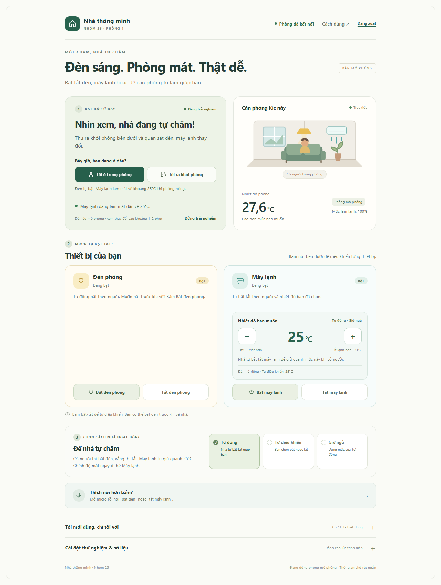

# Nhà thông minh · Nhóm 26

Điều khiển đèn và máy lạnh bằng nút bấm, giọng nói hoặc chế độ tự động.
ESP32 chạy trong Wokwi, giao tiếp MQTT với Node-RED và Dashboard 2.0.



## Lấy code và chạy lần đầu

Yêu cầu: Windows, Git, Node.js từ phiên bản 22.13, VS Code và extension Wokwi đã kích hoạt.

```powershell
git clone https://github.com/Tarento1233/nhom26-smart-home.git
cd nhom26-smart-home
```

1. Chạy **`cai_dat_node_red.bat`** một lần để cài thư viện.
2. Chạy **`khoi_dong_demo.bat`** để mở dashboard và workspace Wokwi.
   Đăng nhập bằng tài khoản tự sinh trong **`node_red/data/TAI_KHOAN_DEMO.txt`**.
   Mỗi máy có tài khoản riêng; không gửi file tài khoản lên GitHub hoặc group.
3. Trong VS Code, chọn **F1 → Wokwi: Start Simulator**. Firmware đã có sẵn;
   không cần build lại khi chỉ chạy thử bản này.
4. Giữ Wokwi hiển thị cạnh dashboard. Chờ **Phòng đã kết nối**, rồi bấm
   **Bắt đầu trải nghiệm**.

- Dashboard: <http://localhost:1880/dashboard/room>
- Giọng nói: <http://localhost:1880/voice/voice.html>
- Flow editor: <http://localhost:1880>

Xem [hướng dẫn bắt đầu](BAT_DAU_O_DAY.md) và [kịch bản thử 5 phút](TEST_NHANH_5_PHUT.md).
Home Assistant là phần mở rộng, không bắt buộc để chạy demo.

## Lấy bản cập nhật

Dừng Wokwi và chạy `tat_node_red.bat`, rồi mở terminal trong thư mục dự án:

```powershell
git pull --ff-only
```

Nếu `node_red/package.json` hoặc lockfile thay đổi, chạy lại `cai_dat_node_red.bat`.
Sau đó chạy `khoi_dong_demo.bat`, mở Wokwi và nhấn Ctrl+F5 trên dashboard.
Không cần tải lại ZIP. Nếu đã sửa code trên máy mình, lưu commit trước khi pull.

## Gửi thay đổi của mình lên GitHub

```powershell
git status
git add .
git commit -m "Mo ta thay doi"
git push
```

Cần quyền ghi vào repo để push; các thành viên khác vẫn clone và pull được repo Public.
[Hướng dẫn Git cho nhóm](HUONG_DAN_GITHUB.md) giải thích thao tác lần đầu và cập nhật.

## Cách hoạt động

- **Tự động / Giờ ngủ:** đèn theo người; máy lạnh tự giữ theo nhiệt độ bạn chọn (mặc định 25°C).
- **Tự điều khiển:** giữ lệnh đến khi bạn đổi chế độ, cho phép bật đèn khi phòng vắng.
- **Chỉnh máy lạnh 16–31°C:** chọn chế độ rồi bấm **− / +** ở thẻ Máy lạnh.
  Tự điều khiển và Tự động nhớ mức riêng, kể cả sau khi khởi động lại Node-RED.
  Giờ ngủ dùng mức của Tự động. Đổi nhiệt độ giữ nguyên chế độ; khi tự điều khiển,
  bấm **Bật máy lạnh** nếu máy đang tắt. Nhiệt độ phòng thay đổi dần theo mức đặt.
  Trang giọng nói cũng có nút chỉnh và hiểu câu **“máy lạnh 22 độ”**.
- Mô phỏng tự phục hồi sau khi Wokwi kết nối lại; có thể dừng trong lúc chờ phản hồi.
- MQTT chạy bằng broker Aedes riêng trên máy, có tài khoản và phân quyền topic.
  Wokwi và nhận giọng nói vẫn cần Internet. Bản demo chỉ mở trên localhost;
  truy cập từ bên ngoài nhà chưa được cấu hình.

Chỉ chạy một mô phỏng trên bộ topic `nhom26/room1` tại một thời điểm khi demo chung.

## Cấu trúc và kiểm thử

| Thư mục | Nội dung |
|---|---|
| `wokwi/` | Firmware ESP32, mạch, cấu hình VS Code và bản build sẵn |
| `node_red/` | Rule, mô hình phòng, dashboard và flow có thể import |
| `voice/` | Trang điều khiển giọng nói |
| `home_assistant/` | Cấu hình MQTT và discovery tùy chọn |
| `test/` | Kiểm thử logic, MQTT và trình duyệt |

```powershell
cd node_red
npm test
```

Đã đạt **64 kiểm thử logic và 60 bước tích hợp**, gồm đăng nhập HTTP/MQTT, ACL, SQLite và trình duyệt.
Xem [báo cáo](KET_QUA_KIEM_THU.md); các log/ảnh lịch sử trong `node_red/data/` là
dữ liệu chạy trên máy gốc và không được lưu trong Git.

Khi sửa giao diện hoặc rule, chạy `node scripts/build-flows.cjs` trong `node_red/`
trước khi commit để `flows.json` khớp nguồn. Khi sửa firmware, build theo
[hướng dẫn Wokwi](wokwi/README.md) và cập nhật cả hai file firmware đang được theo dõi.

## Xác thực và Database

- Đăng nhập trước khi xem dashboard, trang giọng nói, API hoặc flow editor.
- MQTT TCP `127.0.0.1:1883`, WebSocket `127.0.0.1:1884/mqtt`.
  Tài khoản riêng cho ESP32, controller, voice và Home Assistant. Sai mật khẩu bị từ chối;
  quyền đọc/ghi topic phụ thuộc vai trò.
- Firmware không chứa mật khẩu. Khi Wokwi chạy trong VS Code, dịch vụ cấp tài khoản
  tự động qua serial RFC2217 cổng 4000. Dùng firmware và `wokwi.toml` mới trong repo.
- SQLite lưu cảm biến, lệnh, chế độ, nhật ký xác thực và phiên đăng nhập ở
  `node_red/data/smart_home.sqlite`. CSV cũ được nhập một lần.
- Mở **Cài đặt thử nghiệm & số liệu → Lịch sử đã lưu → Xem lịch sử** để lọc dữ liệu.
  Tải CSV lấy dữ liệu từ database. Khởi động lại vẫn giữ lịch sử.

Xem [hướng dẫn Authentication và SQLite](docs/XAC_THUC_VA_DATABASE.md).
